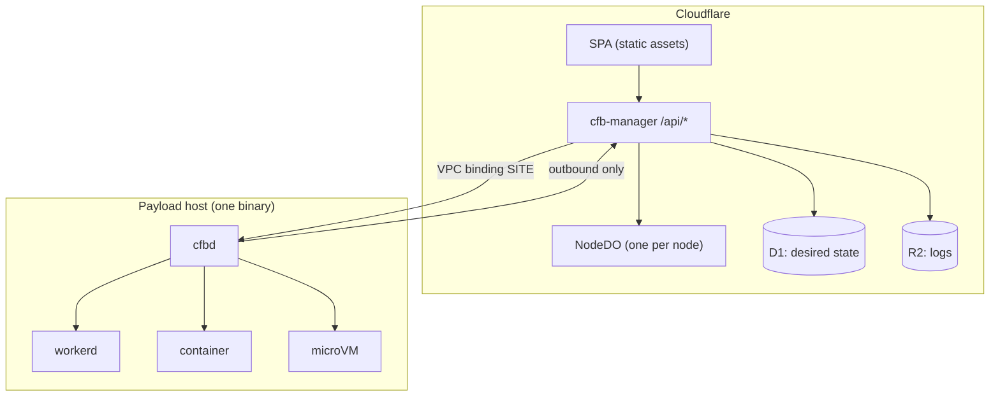

# cfb

A portable workload platform. One application source runs on Cloudflare Workers or on
self-hosted hardware. One agent binary per host carries the connection, the RPC broker, the
supervisor, the metrics and the local API.

The manager stays on Cloudflare because it must be up when the fleet is not. Everything that
serves traffic, holds state or runs code lives on hardware the operator controls.

## Requirements

| # | Requirement |
|---|---|
| R1 | **Portability.** Application source runs unchanged on Cloudflare Workers and on a self-hosted runtime. Nine of the thirteen forks are absorbed by one adapter package, three are one-time rewrites, and one has no self-hosted equivalent. |
| R2 | **One agent.** Exactly one binary per payload host owns the connection, the RPC broker, supervision, metrics and the local API. |
| R3 | **Manager on Cloudflare.** One Worker serves the SPA and the API and is the only place control-plane credentials live. |
| R4 | **No inbound ports.** Payload hosts accept no inbound connection; every path is outbound or a unix socket. |
| R5 | **Control plane carries management traffic only.** No scheduler consensus, no machine-to-machine replication, no bulk data. |

## Topology



`cfbd` dials out and holds one connection. The control plane pushes desired state and calls
capabilities over it. Nothing on a payload host listens on a public interface.

## The portability contract

Application code targets the **Portable Workers Subset** — sixteen APIs that run unchanged on
both runtimes. Everything outside it is one of thirteen forks: nine have an adapter in
`@cfb/port`, three are one-time rewrites, and one (Workers AI, Vectorize, Hyperdrive, Browser
Rendering) has no self-hosted equivalent.

| Level | Targets | Cost of switching |
|---|---|---|
| Application runtime | Cloudflare Workers; `workerd` with celld for Durable Objects | once per application |
| Capability | storage, sql, queue, sandbox, actors, cache, secrets, crypto, workflow, clock, geo | per deployment, configuration only |

The full subset, the fork table and the enforcement rules are in
[`docs/01-portability.md`](docs/01-portability.md).

## Stack

| Layer | Choice | Licence |
|---|---|---|
| Manager | Worker + Static Assets + D1 + R2, one `NodeDO` per node | proprietary |
| Node agent | `cfbd`, one static binary per host | 0BSD |
| Workers runtime | `workerd`, or celld for a Durable Objects fleet | Apache-2.0 |
| Containers | Docker Engine API (Podman via its compat socket) | Apache-2.0 |
| Untrusted code | Firecracker, with gVisor where there is no KVM | Apache-2.0 |
| Object storage | any S3 endpoint: R2, SeaweedFS, RustFS, Garage | proprietary / Apache-2.0 / AGPL-3.0 |
| Connectivity | `cloudflared` for the tunnel; Headscale for a peer overlay | Apache-2.0 / BSD-3-Clause |
| CI | Woodpecker with Dagger | Apache-2.0 |

Per-project licences, statuses and constraints are in [`reference/stack.md`](reference/stack.md).

## Documents

| Document | Contents |
|---|---|
| [`docs/01-portability.md`](docs/01-portability.md) | the Portable Workers Subset, the 13 forks, capability adapters, enforcement |
| [`docs/02-agent.md`](docs/02-agent.md) | `cfbd`: process model, connection, wire protocol, capabilities, supervision, local API, enrolment |
| [`docs/03-workloads.md`](docs/03-workloads.md) | isolation levels, `workerd`, containers, microVMs, placement |
| [`docs/04-storage.md`](docs/04-storage.md) | storage as an S3 endpoint, conditional writes, bucket layout, durability |
| [`docs/05-control-plane.md`](docs/05-control-plane.md) | the Worker, D1 schema, reconcile loop, API, `NodeDO`, connectivity, auth |
| [`docs/06-security.md`](docs/06-security.md) | trust boundaries, scope of impact, risk register, insecure defaults |
| [`docs/07-operations.md`](docs/07-operations.md) | install, upgrade, backup, restore, out-of-band access, monitoring |
| [`docs/08-orchestration.md`](docs/08-orchestration.md) | the cell lease model for a self-hosted celld fleet |
| [`docs/09-cost.md`](docs/09-cost.md) | unit costs, break-even, labour sensitivity |
| [`docs/10-rollout.md`](docs/10-rollout.md) | migration phases and exit criteria |
| [`reference/stack.md`](reference/stack.md) | per-layer project, licence, status and constraint |
| [`agent/`](agent/) | `cfbd` crate: frame codec, config, host probes, supervision primitives |

## The agent crate

`agent/` is a Rust crate with no dependencies. It implements the parts of `cfbd` that are local
and testable without a network:

```sh
cd agent && cargo test
```

- `protocol` — the frame codec for all twelve messages, with round-trip tests
- `config` — `/etc/cfbd/config.toml` loading with `CFB_*` overrides and validation
- `doctor` — KVM, container socket and egress probes
- `supervise` — payload spawn, readiness gating, log capture, restart backoff

Transport and the live connection to `cfb-manager` are not implemented. `cfbd run` validates
configuration, probes the host and exits with `EX_UNAVAILABLE`; `cfbd doctor` reports the host
capability line. See [`docs/02-agent.md`](docs/02-agent.md) for the protocol this implements.

## Scope

In scope: one organisation's fleet, placed by a filter and a sort, on hardware it owns, with
the dashboard on Cloudflare.

Out of scope: gang scheduling, preemption, affinity beyond labels, a VM provisioning API, a
scheduler with its own consensus, and hosting workloads for other organisations. See
[`docs/10-rollout.md`](docs/10-rollout.md).

## Licence

0BSD. See [`LICENSE`](LICENSE).
